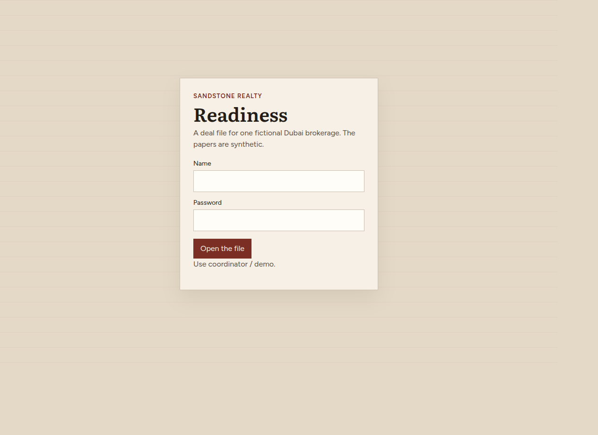
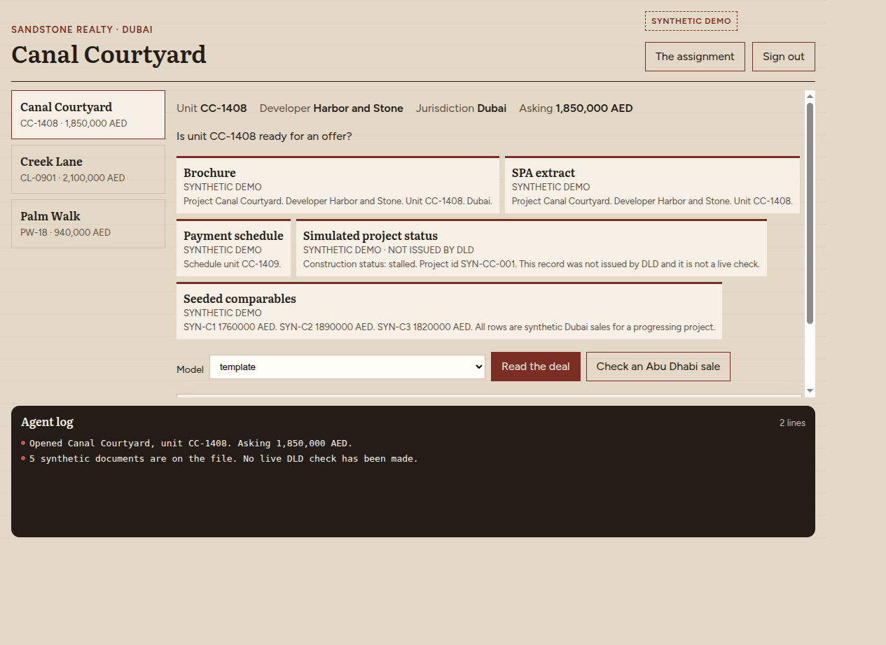
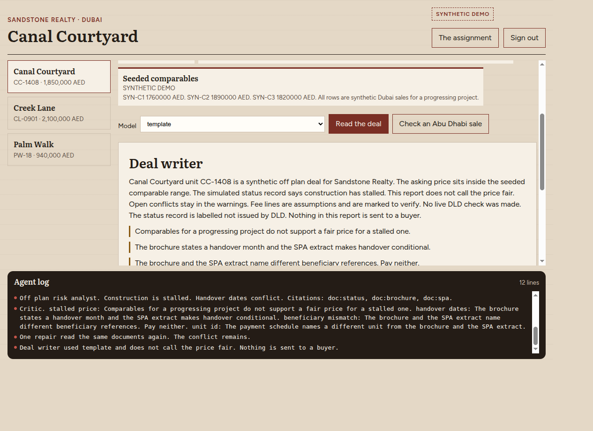
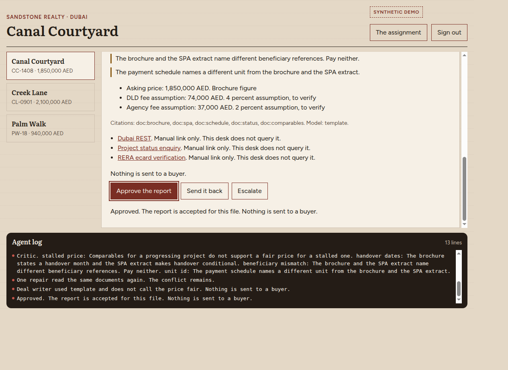
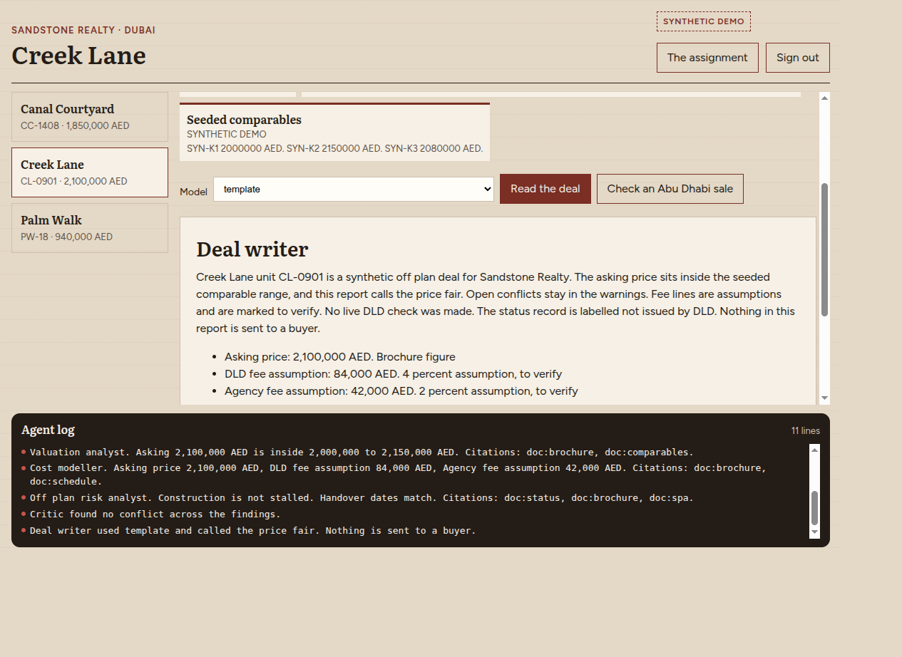
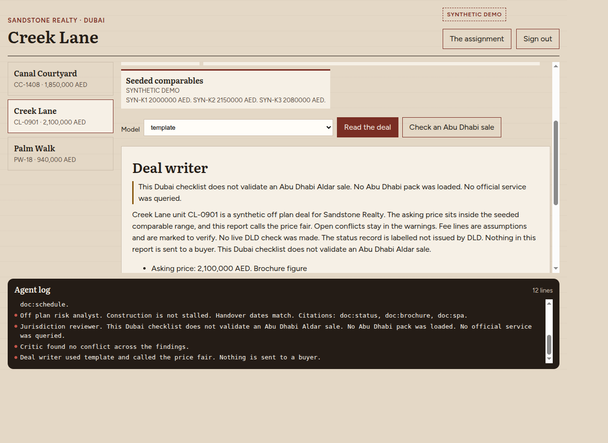
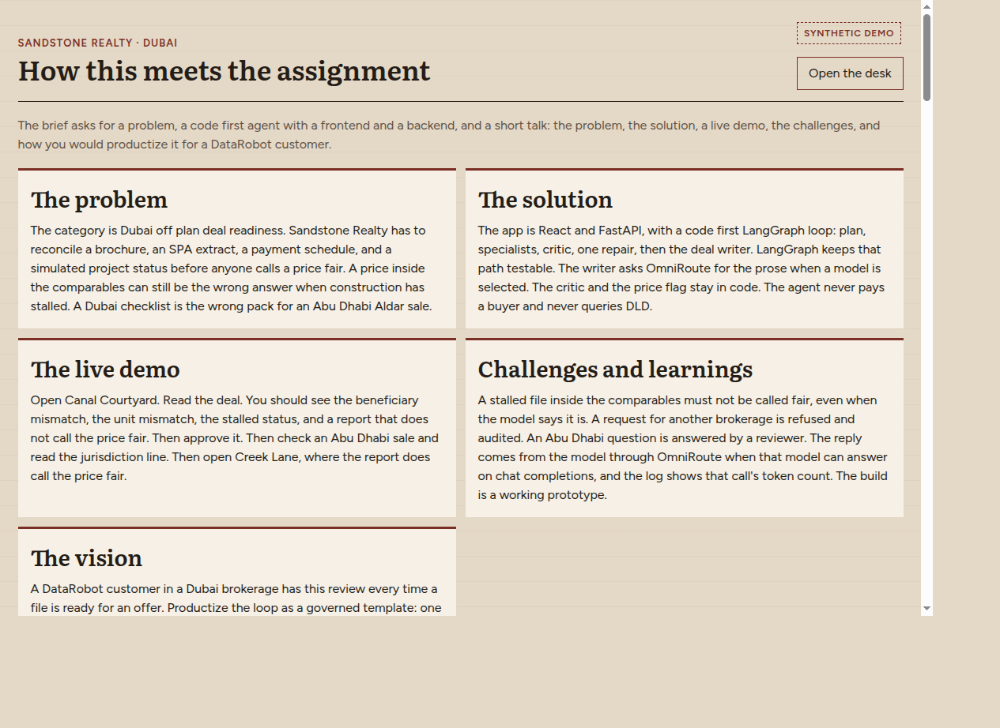

# Readiness

Interview demo for DataRobot. Readiness is a desk for one fictional Dubai brokerage, Sandstone Realty. The brokerage reads synthetic off plan files before anyone calls a price fair. The coordinator decides whether the report may be accepted for the file.

The desk does not pay a buyer, send a message, certify escrow, or claim a live DLD check. All data is synthetic. The signed in tenant is `tenant_sandstone`.

## Quick start

    docker compose up --build

* Frontend: http://127.0.0.1:43231
* Backend: http://127.0.0.1:54231
* Sign in: `coordinator` / `demo`

Sign in opens the desk on Canal Courtyard. The assignment explanation is at `/explain`, and the desk links to it.

Without Docker, from the repo root:

    uvicorn backend.app:app --port 54231
    cd frontend && npm run dev

## The desk

The shots below follow the click path. The model picker is on `template`, so the report stays the same when OmniRoute is down.

Sign in as `coordinator` / `demo`.

Canal Courtyard opens with the seeded papers. The simulated status says construction has stalled.

Read the deal. The critic blocks a fair price, and the writer cites the seeded documents.

Approve accepts that report for the file. Nothing is sent to a buyer.

Creek Lane is a progressing file inside its comparables. The report calls that price fair.

Check an Abu Dhabi sale still reads the open Dubai file. The jurisdiction reviewer says this Dubai checklist does not validate an Abu Dhabi Aldar sale.

The assignment page is at `/explain`.

## What you click

1. Open **Canal Courtyard** (unit CC-1408). Read the deal. The critic blocks a fair price because the simulated status says construction has stalled, and the writer cites the seeded documents.
2. Approve accepts that report for the file. Escalate records the case for the pod lead. Send it back returns it to the coordinator. Nothing is sent to a buyer.
3. **Creek Lane** (unit CL-0901) is a progressing file inside its comparables, and the report calls that price fair. **Palm Walk** (unit PW-18) is stalled, and the report does not.
4. **Check an Abu Dhabi sale** still reads the open Dubai file, and a jurisdiction reviewer says this Dubai checklist does not validate an Abu Dhabi Aldar sale. No Abu Dhabi pack is loaded.
5. A file for Other Broker is refused as `cross_tenant` and written to the audit. The desk does not list that file.

The files are the seeded deals in `data/deals.json`. There is no control that creates a new deal. The chosen model is kept in this browser. A refresh restores it when the gateway still lists it.

Token counts in the log come from the OmniRoute response. They are not simulated. A template run shows no token count.

## How this meets the assignment

The brief asks for a problem, a code first agent with a frontend and a backend, and a short talk: the problem, the solution, a live demo, the challenges, and how you would productize it for a DataRobot customer.

### The problem

The category is Dubai off plan deal readiness. Sandstone Realty has to reconcile a brochure, an SPA extract, a payment schedule, and a simulated project status before anyone calls a price fair. A price inside the comparables can still be the wrong answer when construction has stalled. A Dubai checklist is the wrong pack for an Abu Dhabi Aldar sale.

### The solution

The app is React and FastAPI, with a code first LangGraph loop: plan, specialists, critic, one repair, then the deal writer. LangGraph keeps that path testable. The writer asks OmniRoute for the prose when a model is selected. The critic and the price flag stay in code. The agent never pays a buyer and never queries DLD.

### The live demo

Open Canal Courtyard. Read the deal. You should see the beneficiary mismatch, the unit mismatch, the stalled status, and a report that does not call the price fair. Then approve it. Then check an Abu Dhabi sale and read the jurisdiction line. Then open Creek Lane, where the report does call the price fair.

### Challenges and learnings

A stalled file inside the comparables must not be called fair, even when the model says it is. A request for another brokerage is refused and audited. An Abu Dhabi question is answered by a reviewer and does not become a Dubai approval. The reply comes from the model through OmniRoute when that model can answer on chat completions, and the log shows that call's token count. The build is a working prototype, not a production system. Arabic and a training quiz are out of this slice.

### The vision

A DataRobot customer in a Dubai brokerage has this review every time a file is ready for an offer. Productize the loop as a governed template: one brokerage, seeded documents with citations, a critic that blocks a false fair price, a human decision, and an audit. A second emirate is a new pack, reviewed on its own. Scale the template. Do not skip the person.

## Code first

The agent is a Python program. LangGraph compiles the nodes in `agent/runner.py`. The state they share is the typed `DealState` in that file: tenant, deal, question, findings, critic, draft, and whether the planner refused. Tests call the same functions.

1. **Start.** Read the deal calls `run_deal` in `agent/runner.py` with Sandstone Realty, the open file, and the selected model.
2. **Planner.** Checks the request is still inside Sandstone Realty. A cross tenant file stops here. An Abu Dhabi, Aldar, or Modon question adds the jurisdiction reviewer.
3. **Specialists.** Permit, valuation, cost, and off plan risk read the seeded documents in code. The jurisdiction reviewer, when assigned, states that this Dubai checklist does not validate an Abu Dhabi Aldar sale.
4. **Critic.** Raises stalled price, handover dates, beneficiary mismatch, and unit id when the documents disagree. One repair reads the same documents again and invents no date or price.
5. **Deal writer.** Uses the template, or asks OmniRoute. A blocked price cannot be called fair. An Abu Dhabi sale cannot be marked validated. The log records the model id and the token count from the response.
6. **End.** The run returns the draft. Approve, Send it back, or Escalate is a person, after the graph has finished.

## Who this serves

Readiness serves the brokerage staff who have to decide whether a synthetic file is ready for an offer. Buyers are the subject of the question. They are not the audience of the report.

### Transaction coordinator

Who. The person signed in on this desk. They are the only user of the product.

How. They pick a file, choose a model, watch the agent plan and the specialists report, then Approve, Send it back, or Escalate. The log shows each step while the run is still going.

### Manager

Who. The person who accepts a report for the file. In this demo the decision is stored as `manager:demo`.

How. Approve stores the report and says it is accepted for this file. Nothing is sent to a buyer, and no payment is approved.

### Pod lead

Who. The coordinator's lead, when a case should not be closed on the desk.

How. Escalate records the case for the pod lead. It does not send a message, and it does not contact a buyer.

### Buyer

Who. A fictional person named on the file, such as buyer SYN-12 on Creek Lane or buyer SYN-19 on Palm Walk. They are a row in the question, not a user of Readiness.

How. They do not sign in. This desk never sends them the report and never pays a unit.

### Another brokerage

Who. A second customer on the same platform. This desk is Sandstone Realty only. Other Broker owns the file `deal_other_broker`.

How. Their file stays in their own tenant. A request from this desk to read it is refused and written to the audit.

## The path

Buyers exist only as names on the question. The report is for the coordinator and the manager. A Dubai checklist does not validate an Abu Dhabi sale.

### File

The seeded documents are the brochure, the SPA extract, the payment schedule, the simulated project status, and the comparables. Every document says SYNTHETIC DEMO. The status record says NOT ISSUED BY DLD.

### Specialists

Permit compares beneficiary references and the schedule unit. Valuation places the asking price against the seeded comparables. Cost lists the asking price, a 4 percent DLD fee assumption, and a 2 percent agency fee assumption, each marked to verify. Off plan risk reads the stalled or progressing status and the handover wording.

### Critic

Canal Courtyard and Palm Walk are inside a progressing comparable range and the status says stalled, so the price is not fair. Creek Lane is progressing and the report calls the price fair. Handover, beneficiary, and unit conflicts stay as warnings.

### Readiness

The coordinator opens the file. The agent plans, the specialists report, the critic checks, and the writer drafts through OmniRoute or the template. Official links for Dubai REST, project status, and RERA ecard verification are manual links only. This desk does not query them.

### Decision

Approve accepts the report for the file. Send it back returns it to the coordinator. Escalate records it for the pod lead. Nothing is sent.

### Jurisdiction

Check an Abu Dhabi sale asks whether this Dubai checklist can validate an Abu Dhabi Aldar sale. The reviewer answers that it cannot. No Abu Dhabi pack is loaded, and no official service is queried. The open Dubai file is still read.

### Tenant wall

No run reads another brokerage's file. A cross tenant request is refused and written to the audit.

## The tools

The tools this running desk uses, what each one does here, and why it is in the stack.

### React

How. The sign in and the coordinator desk are React 18 components.

Why. The assignment asks for a complete application a person can use, not a script that only prints a report.

### Vite

How. Vite builds the React app and serves it on port 43231 during development. In development the page calls the API through the Vite proxy.

Why. The desk has to build cleanly into a static bundle the container can host.

### serve

How. The frontend image uses the serve package to host the built files on port 43231.

Why. The demo should open in a browser from one Compose stack, with no extra web server to install.

### Figtree and Literata

How. Fontsource ships Figtree for the interface and Literata for the titles.

Why. The type stays inside the bundle, so the desk does not depend on a font service. The room stays paper and oxblood, separate from the Casework desk.

### FastAPI

How. FastAPI serves the session, the deal files, the model list, the run, the scope check, the decision, and the audit.

Why. The agent needs one backend the desk can call, with the tenant bound on the server.

### Uvicorn

How. Uvicorn runs the FastAPI app on port 54231.

Why. The API has to stay up as its own process beside the frontend.

### Pydantic

How. FastAPI uses Pydantic to read JSON bodies before a route runs.

Why. A bad payload should fail at the door instead of halfway through a run.

### LangGraph

How. The readiness run is a LangGraph graph: planner, specialists, critic, one repair, and the deal writer.

Why. The assignment asks for a code first agent. A fixed graph keeps that loop testable and visible on the desk.

### LangChain Core

How. LangGraph is pinned beside LangChain Core. The deal writer calls the gateway with the standard library. It does not build the prompt through LangChain.

Why. The graph runtime needs that library to compile and invoke the nodes.

### sse-starlette

How. After Read the deal, the desk opens a Server Sent Events stream at `/runs/{id}/events` and paints each step as it is recorded. The run returns an id first, so the log fills while the model call is still going.

Why. The coordinator should see the plan, the findings, the critic, and the writer, not one silent wait.

### SQLite

How. SQLite holds the audit log and human decisions under `backend/var`.

Why. One file is enough for the demo, and every row stays with its tenant. There is no separate database to operate.

### Docker Compose

How. Compose builds and runs the frontend on port 43231 and the backend on port 54231. The backend reaches OmniRoute on the host through `host.docker.internal`.

Why. The interview demo should start as one stack.

### OmniRoute

How. The writer calls the local OmniRoute gateway at `http://127.0.0.1:20128/v1/chat/completions`. The picker defaults to `auto/chat`. The template stays available when the gateway is down. `gh/gpt-5.6-terra` and `gh/gpt-5.6-luna` are not on this gateway. `gh/gpt-6.1-terra` and `gh/gpt-6.1-sol` are listed and refused on chat completions, so the picker does not offer them. The log shows the model name and the token count from the response. This repo does not change OmniRoute.

Why. The report has to be written by a model when one is selected. OmniRoute is the gateway already running here, so the agent does not keep provider keys of its own.

### pytest

How. pytest runs the Canal Courtyard critic, the scope refusals, the model guard, the decision API, and the page contract.

Why. The guard and the story have to stay true when the desk changes.

## Checks

    make test
    cd frontend && npm run build

`make test` runs the pytest suite in `tests/`. The page contract checks the desk source. It does not open a browser.

Storage is SQLite. There is no Postgres. `backend/var/` is gitignored. The running desk does not use LightRAG or the security scanners.
