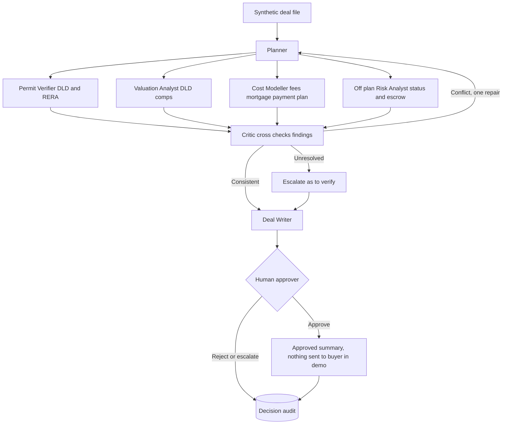
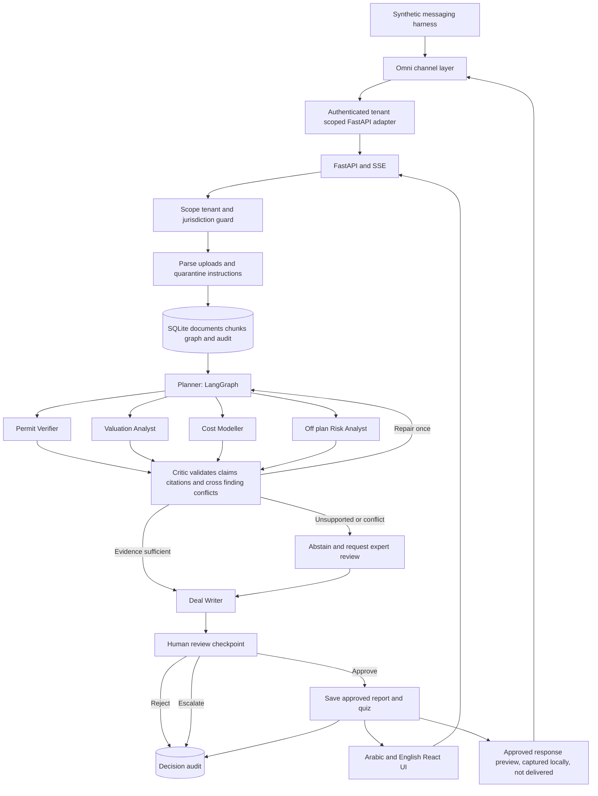

# D: UAE Real Estate Deal Readiness Agent Team

Project brief. Research checked on 7 November 2026, Asia/Dubai (UTC+4). Status: planning only. No application has been built or deployed.

## Business problem and UAE context

A brokerage must reconcile sales promises, SPA clauses and official project evidence before answering buyers. New brokers also need to learn which claims require verification rather than repeating a brochure. A cited deal readiness workflow is a concrete business use for document learning, Q&A and quizzes.

Start with Dubai only. DLD's Dubai REST service describes access to off plan project completion information, project photos, escrow account numbers and developer and broker information [R1]. The official Project Status Enquiry points users to Project Status (Mashrooi) in Dubai REST [R2]. RERA ecard verification enables customers to verify the card issued to real estate practitioners in Dubai [R3]. These are official verification channels, not evidence that a particular synthetic project or transaction is registered.

The demo should ask whether project identity, developer, escrow instructions and broker status have supporting evidence. It must never claim a live DLD check occurred when it only read a seeded document. No automated DLD API access is assumed. Access rights, current legal requirements, escrow obligations and transaction specific documentation are “to verify” with the official service and qualified counsel before production.

Emaar, Modon and Aldar are examples of developer document families that a future customer might use, not partners or endorsed data providers. Developer branding does not determine jurisdiction. DLD and RERA rules are Dubai specific. Abu Dhabi projects require a separately reviewed regulatory pack before supporting Modon or Aldar transactions there. Do not apply Dubai checklists across the UAE.

## Why this needs a team of agents

A buyer's due diligence covers separate areas that need different evidence: the permit and broker status, the price, the full cost of ownership, and off plan delivery risk. A single agent tends to answer each question in isolation and miss conflicts between them, for example a price that looks fair for a project that has stalled. Parallel specialists each own one area, a Critic looks specifically for contradictions across their findings, and a human approver decides before any offer or summary reaches a buyer.

The design extends the Planner, Operator and Checker pattern already used in Hermes and in the DataRobot Demo: the planner assigns the specialists, the specialists operate, and the Critic is the checker. The UAE Tax and eInvoicing team is the recommended primary demo. This team is the secondary option.

## Agent team

| Agent | Role | Inputs | Outputs | Tools |
|---|---|---|---|---|
| Planner | Builds the due diligence checklist and assigns specialists | Deal file, project and unit IDs | Work items per specialist, run state, SSE progress events | LangGraph state, audit log |
| Permit Verifier | Checks the listing, project, developer and broker against DLD and RERA evidence | Brochure, SPA extract, simulated official verification records | Verified, mismatch or "to verify" per item, with citations | Versioned retrieval, deterministic ID comparison, manual links to official services |
| Valuation Analyst | Prices the unit against DLD transaction comparables | Unit details, synthetic comparable transactions | Price range with the comparables used | Deterministic comparison over a seeded synthetic comparables table |
| Cost Modeller | Works out DLD fee, agency fee, mortgage and payment plan | Price, payment schedule, financing assumptions | Itemised cost schedule with stated assumptions | Deterministic arithmetic, reviewer approved fee assumptions |
| Off plan Risk Analyst | Assesses project status and escrow position | Project status record, escrow details, SPA handover clause | Delivery and escrow risk notes with citations | Versioned retrieval, beneficiary reference comparison |
| Critic | Looks for conflicts between the specialists' findings | All specialist outputs | Conflicts raised, sent back for one repair or escalated | Independent model call, cross finding rules |
| Deal Writer | Drafts the offer or deal readiness summary | Critic approved findings | Draft summary with every claim cited | Template, citation checker |
| Human approver | Manager or conveyancing professional who decides | Draft, conflicts, open questions | Approve, reject or escalate, recorded in the audit trail | Approval UI |

### Orchestration flow and handoffs

1. The Planner builds the checklist and dispatches the four specialists in parallel.
2. The Permit Verifier, Valuation Analyst, Cost Modeller and Off plan Risk Analyst each return cited findings.
3. The Critic compares the findings. A conflict goes back to the relevant specialist for one repair, then escalates if unresolved.
4. The Deal Writer drafts only from findings the Critic has passed, carrying open conflicts forward as explicit warnings.
5. The Human approver decides. Nothing is sent to a buyer in the demo, and nothing leaves the system without approval.

### Scripted demo moment: one agent catches another

The Valuation Analyst reports that the synthetic Canal Courtyard unit is priced within the range of seeded comparables. Independently, the Off plan Risk Analyst finds that the simulated project status record shows construction has stalled. Each finding looks reasonable alone. The Critic flags the conflict: comparables for a progressing project do not support a fair price for a stalled one. The Deal Writer is blocked from calling the price fair, and the conflict goes to the human approver as a named warning.

### Rubric mapping

| Criterion | How the team design addresses it |
|---|---|
| Problem Solving Acumen | Due diligence decomposed into independent areas, each owned by a specialist with its own evidence |
| Strategic Vision | Brokerage workflow that can extend to more jurisdictions through separately reviewed regulatory packs |
| Technical Credibility | Functional parallel multi agent workflow, deterministic checks, Critic loop, human gate and audit trail |
| Creativity and Passion | Visible moment where the Critic catches a conflict no single specialist could see |

## Target users and business value

Primary users are Dubai brokerage team leads, transaction coordinators and new brokers. A qualified manager or conveyancing professional approves deal summaries. Clients receive only a reviewed export, never an unapproved agent response.

Value hypotheses are faster evidence assembly, fewer inconsistent answers, clearer handover to legal review and shorter onboarding. The product is not a property valuation engine, title verification service or investment recommendation tool. No return on investment, legal sufficiency or guaranteed completion is promised.

## Live demo storyline: 6 minutes

1. Minute 0 to 1: choose fictional Dubai brokerage Sandstone Realty and synthetic project Canal Courtyard. Show that the project, developer, unit and deal are invented, and introduce the agent team on screen. A synthetic buyer question arrives through the Omni messaging harness.
2. Minute 1 to 2: upload a synthetic brochure, SPA extract, payment schedule and clearly labelled simulated official verification record. The Planner builds a checklist and dispatches the four specialists in parallel, visible in the SSE trace.
3. Minute 2 to 3: the Off plan Risk Analyst finds the brochure promises one handover date while the SPA states a conditional date. Both citations are shown and the conflict is escalated instead of resolved by invention.
4. Minute 3 to 4: the Valuation Analyst calls the price fair against comparables, while the project status record shows a stall. The Critic flags the conflict and blocks the Deal Writer from calling the price fair. The Permit Verifier also spots different beneficiary references between two synthetic documents and recommends official verification. No agent can approve a payment or certify escrow validity.
5. Minute 4 to 5: ask in Arabic whether a Dubai checklist can validate an Abu Dhabi Aldar transaction. The guard refuses jurisdictional overreach and explains the missing source pack. Show a manual link to the official verification service without claiming it was queried.
6. Minute 5 to 6: the Deal Writer produces a draft with warnings, and a manager approves a limited missing evidence report. A new broker answers three cited quiz questions and sees the clause behind a wrong answer. The approved response is captured in the Omni harness with its audit link. No message is sent to a buyer.

## MVP versus later

MVP covers one Dubai synthetic off plan deal, PDF and text ingestion, cited bilingual Q&A, clause extraction, deterministic identity and schedule consistency checks, missing evidence flags, human approval and a short training quiz. A checklist item is a product review control unless an authoritative legal source establishes it as mandatory.

Later add an independently reviewed Abu Dhabi pack, lawful developer document connectors, authenticated official verification integrations if available, role based training, richer comparison across SPA versions and optional audio summaries. Do not include conveyancing, investment scoring, live inventory, bookings, deposits, AML certification, contract signing or actual DLD submissions in the MVP.

## Synthetic data plan

Create a fictional brochure, SPA extract, payment schedule, internal brokerage checklist and simulated verification result. Seed conflicting handover wording, mismatched unit IDs, missing verification dates and inconsistent beneficiary references. Include an Arabic question set and a jurisdiction trap. Do not use actual buyers, Emirates IDs, passports, title deeds, signatures or bank accounts. Use explicitly invalid tokens such as SYNTHETIC_ACCOUNT_NOT_PAYABLE.

Every generated page must say SYNTHETIC DEMO. The simulated official record must also say NOT ISSUED BY DLD and avoid official seals. Keep approved public regulatory references in a separate corpus with URLs and retrieval dates. Use no developer marketing claims without an actual versioned source; the initial brochure is fictional and must not bear a real developer logo.

## Evals and success metrics

Proposed targets, not achieved results: detect all seeded identity and payment schedule discrepancies in 15 deterministic tests; abstain on all 10 missing official verification cases; block all 10 cross tenant attempts; escalate all 5 jurisdiction traps and all known source conflicts. Every material claim must point to an entailing source, not just a nearby chunk.

A domain reviewer assesses a fixed 30 question synthetic benchmark. Target at least 90% accepted answers and review five Arabic answers for meaning and RTL readability. Record false reassurance explicitly as a critical failure. Measure source retrieval recall, missing item precision, review minutes, live latency and actual model usage. Quiz improvement is an onboarding signal only, not proof that a broker is licensed or qualified.

## Real estate specific risks

Marketing copy is not an official project status check or a substitute for the executed agreement. A simulated record never establishes legal title, completion progress, valid escrow or a licensed practitioner. Expired verification evidence triggers a visible warning. Keep source authority, jurisdiction and date distinct. Route contract interpretation to legal review and beneficiary discrepancies to a human; do not supply payment instructions or suggest that a flagged deal is fraud without evidence.

## Official real estate source register

[R1] DLD Dubai REST, published capabilities including project information, escrow information and broker details: https://dubailand.gov.ae/en/eservices/dubai-rest/

[R2] DLD Project Status Enquiry, Mashrooi verification route: https://dubailand.gov.ae/en/eservices/real-estate-project-status-landing/real-estate-project-status

[R3] DLD RERA ecard verification, service scope and procedure: https://backoffice.dubailand.gov.ae/en/eservices/validate-e-card-overview/

[R4] DLD How do I, project status guidance: https://dubailand.gov.ae/en/how-do-i/

## Architecture and implementation

This is a proposed application, not a working product yet. Build code first with a FastAPI backend, React and Vite frontend, and a LangGraph workflow. Use SSE to expose actual agent progress. Every run carries a tenant ID, source versions, tool results, approval state and an audit trail.

Each agent is a LangGraph node with its own prompt, allowed tools and output schema. The Planner plans, the four specialists and the Deal Writer operate, and the Critic is the checker.

The checker must validate source entailment, not merely the presence of a citation. A second model alone is not proof. Numeric comparisons and required field checks run as deterministic code. Bound repair to one attempt, then abstain. Uploads are untrusted data and cannot grant tools or override system instructions. Approval requires a completed run whose checker passed and whose document version has not changed. Reject cross tenant access before retrieval.

Use OmniRoute chat completions at `http://127.0.0.1:20128/v1`, with `gh/gpt-5.6-terra` as the primary model and `gh/gpt-5.6-luna` as a controlled fallback. Record the actual selected model and retry reason. `ollama/qwen3-coder:30b` is a local option whose Arabic and domain quality must be evaluated. Routing locally does not establish where an upstream provider processes data. Do not change Hermes or OmniRoute configuration.

### Requirements: Omni messaging channel layer

[Omni](https://github.com/automagik-dev/omni) is a required integration component for the planned messaging experience. It does not replace the LangGraph agent team or the OmniRoute model gateway. Omni is an Apache 2.0 licensed TypeScript omnichannel messaging platform for AI agents, built on Bun, Hono, PostgreSQL with Drizzle and NATS JetStream, with a REST and OpenAPI interface, a CLI and SDKs. It provides a unified messaging API, event routing, agent provider bindings and response gates. Its documented channels include WhatsApp through Baileys or Meta Cloud API, Discord, Slack and Telegram.

How this project uses it: connect Omni to a dedicated FastAPI adapter through its webhook agent provider interface. Map each incoming conversation to an authenticated tenant and deal before invoking the Planner. Return only human approved output through the adapter. Preserve message IDs, run IDs, source versions and approval decisions for audit and duplicate delivery protection. Specialist agents never send messages directly.

For the demo, replay synthetic conversations through a local testing channel or fixtures. Show an incoming fictional buyer question, the specialist handoffs, the Critic's warning and the Human approver's decision. Capture the proposed response locally without sending it to a buyer. Activating a production channel or any external delivery needs separate approval.

Runtime requirements are Bun, PM2, PostgreSQL and NATS JetStream. Omni's documented installer manages local PostgreSQL and NATS and exposes its API on port 8882 by default. Keep Omni's PostgreSQL and messaging state separate from the application's SQLite document and audit storage. Use scoped API keys, authenticated webhooks, explicit tenant mapping and protected local service endpoints. This requirement does not authorise installing Omni or changing Hermes or OmniRoute.

Maturity and licence: checked on 8 November 2026, Asia/Dubai, GitHub reported 60 stars, 20 forks, default branch `dev` and latest release v2.261108.2. The README version badge lags the releases, so pin a reviewed release and validate its channel and webhook contracts before implementation. Upstream channel status labels are not production assurance. Preserve Apache 2.0 licence and notice obligations and review transitive dependencies.

Channel and privacy risks: prefer Meta Cloud API for any future approved WhatsApp deployment, subject to Meta business, consent, template and messaging policies. Baileys pairing is not official WhatsApp Business API authorisation and needs a separate terms and account risk review. Chats, contact identifiers, attachments, message logs and cross channel identity links can contain personal data. Apply the UAE PDPL controls in this brief to Omni storage and every channel provider, including processing location, retention, access and deletion. Use synthetic messages and fictional identifiers only in the demo.

### Reuse from DataRobot Demo

Read `/home/abdul/projects/DataRobot-Demo` only as a reference. Reuse its patterns for FastAPI, SSE, LangGraph planner/operator/checker, SQLite GraphRAG, approval decisions, evals and Docker Compose in these new projects after explicit build approval. The existing README confirms these components and its security tooling. Keep ports and storage separate. Optional LightRAG on Ollama comes later only if retrieval evals justify it.

Reuse Gitleaks, TruffleHog, Trivy and Semgrep for this project's own code and containers. Secret verification stays off. Prowler requires separate opt in and approved credentials. Do not copy old security findings into business data or inherit old simulated metrics. `/home/abdul/projects/DataRobot-V2` and its OpenRig builder/reviewer team can support implementation later. No agents have been assigned by this brief.

### Application contract

Proposed routes are `POST /api/documents`, `POST /api/runs`, `GET /api/runs/{id}/events`, `POST /api/runs/{id}/decisions`, and `GET /api/reports/{id}`. Store tenant, document hash, page, source URL, retrieval date, effective date, rule version, model, checker outcome and approval actor. Cite document IDs and exact pages or sections in the UI. Unknown dates display “to verify”. Arabic uses RTL layout with explicit LTR treatment for amounts and identifiers.

## Privacy, security and legal controls

Use only synthetic business documents with visibly fake identifiers. No real client records, PII, credentials, bank details or production documents. Public regulatory material is reference evidence, not a synthetic customer document. Store approved extracts with provenance and respect source terms. Do not scrape authenticated services.

This is an assistant for qualified human review, not tax, legal, investment or regulatory advice. Never label a business or transaction compliant just because a checklist passes. Display missing evidence and scope limitations prominently.

The UAE PDPL governs personal data processing and includes conditions for transfers abroad [P1, P2]. It is not a blanket rule that all data must stay in the UAE. For a production customer, map applicable federal, sector and free zone obligations with counsel. Select UAE hosted storage, inference, backups and logs where required by policy or law. Verify every provider's actual processing location and retention terms. A localhost OmniRoute URL does not guarantee UAE residency. Until that verification, permit only synthetic content to remote models. Design access controls, encryption, retention, deletion, audit access and incident handling before accepting real data.

## DataRobot productization vision

Position this as a repeatable customer solution with a reusable agent core and versioned jurisdiction packs. A DataRobot customer could evaluate model choices, monitor agent quality and latency, govern releases and connect an approved agent service to its enterprise applications. Confirm the customer's DataRobot edition, supported integrations and UAE deployment options before promising features or residency.

Move from SQLite to managed production storage only when scale and tenancy requirements justify it. Add SSO, scoped roles, isolated retrieval, customer managed source approvals, model regression gates, observability and policy version rollback. Charge against validated workflow value rather than promising generic productivity gains. Start with a supervised pilot, measure baseline review effort, then compare expert accepted output and total review time. No claimed savings are measured yet.

## Interview delivery

Allocate the 15 minute presentation as follows: problem and customer value 2 minutes, architecture and tools 3 minutes, live demo 6 minutes, challenges and learnings 2 minutes, and product vision 2 minutes. Demonstrate a refusal or escalation as well as a successful case. Keep a clearly labelled synthetic replay ready if model access fails, and do not present replay timings as live measurements.

## Next steps

1. Confirm this brief and the narrow MVP before coding.
2. Freeze official source versions and have the domain reviewer approve rule interpretations.
3. Author synthetic fixtures and expected results before implementing the graph.
4. Build one complete vertical slice with frontend, backend, citations and approval.
5. Add Arabic review, adversarial evals and container restart persistence checks.
6. Run a timed rehearsal and disclose remaining limitations.

## Shared official privacy sources

[P1] UAE government, Data protection laws: https://u.ae/en/about-the-uae/digital-uae/data/data-protection-laws

[P2] Federal Decree by Law No. 45 of 2021, especially Articles 22 and 23: https://uaelegislation.gov.ae/en/legislations/1972/download
